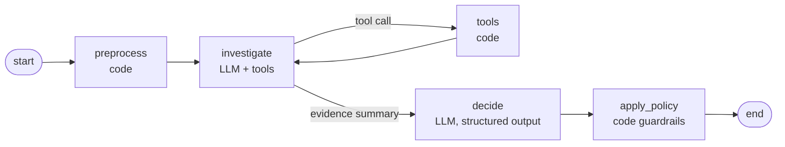

# Support Ticket Triage Agent
# Support Ticket Triage Agent

A LangGraph agent that triages customer-support tickets with an OpenAI GPT model.
For each ticket it classifies urgency, extracts key information, searches a knowledge
base, checks customer/billing/system data with tools, and decides the next action:
**auto-respond**, **route to a specialist**, or **escalate to a human**.

| Requirement | Where it lives |
|---|---|
| 1. Classify urgency | `TriageResult.urgency` — rubric in `DECIDE_SYSTEM_PROMPT` |
| 2. Extract product, issue type, sentiment | `TriageResult.extracted` (`models.py`) |
| 3. Search a knowledge base | `search_knowledge_base` tool (BM25 over `data/knowledge_base.json`) |
| 4. Decide next action | `decide` node + deterministic guardrails in `policy.py` |
| 5. At least 2 tools | 4 tools in `tools.py` |
| System prompt | `src/triage_agent/prompts.py` (`INVESTIGATE_SYSTEM_PROMPT`, `DECIDE_SYSTEM_PROMPT`) |
| Tool definitions (schema + implementation) | `src/triage_agent/tools.py` — print the exact schemas with `python scripts/inspect_tools.py` |
| Write-up | [`WRITEUP.md`](WRITEUP.md) |

## Quick start

Requires Python 3.11+ and an OpenAI API key.

```bash
# macOS / Linux
python -m venv .venv && source .venv/bin/activate
pip install -e ".[dev]"
cp .env.example .env          # then set OPENAI_API_KEY in .env
python -m triage_agent
```

```cmd
:: Windows (cmd)
python -m venv .venv
.venv\Scripts\activate
pip install -e ".[dev]"
copy .env.example .env
:: then set OPENAI_API_KEY in .env
python -m triage_agent
```

## Usage

| Command | What it does |
|---|---|
| `python -m triage_agent` | Triage all sample tickets, readable console output |
| `python -m triage_agent --ticket T-1002` | Triage one ticket (repeatable flag) |
| `python -m triage_agent --json` | Machine-readable output (`TicketOutcome` list) |
| `python -m triage_agent -v` | Also log every tool call as it happens |
| `python scripts/run_evals.py --runs 3` | Score the agent against `evals/golden_set.json` |
| `python scripts/draw_graph.py` | Print the graph as Mermaid (no API key needed) |
| `python scripts/inspect_tools.py` | Print tool schemas and sample tool outputs (no API key needed) |
| `pytest` | 90 tests, no API key needed (LLM replaced by fakes) |

Configuration (`.env`):

| Variable | Default | Notes |
|---|---|---|
| `OPENAI_API_KEY` | — | Required for the agent and evals |
| `OPENAI_MODEL` | `gpt-5.5` | Any OpenAI chat model with tool calling and structured outputs |
| `TRIAGE_DATA_DIR` | `./data` | Folder with the mock data |
| `LANGSMITH_TRACING`, `LANGSMITH_API_KEY` | off | Optional: full traces in LangSmith |

## Architecture



| Node | Type | Responsibility |
|---|---|---|
| `preprocess` | code | Compute wait time / unanswered messages; render the ticket for the LLM |
| `investigate` ⇄ `tools` | LLM + code | ReAct loop: the model chooses tools, tools return verified facts |
| `decide` | LLM | Reads ticket + evidence in a fresh context, returns a strict `TriageResult` |
| `apply_policy` | code | Business rules that can only make a decision safer (e.g. billing never auto-responds) |

Tools (all read-only, mocked from `data/`):

| Tool | Returns |
|---|---|
| `get_customer_profile` | Plan, seats, region, language, account manager, history, tenure |
| `search_knowledge_base` | Top 3 KB articles (BM25) |
| `get_billing_transactions` | Charges, totals, possible duplicates, provisioning errors |
| `check_service_status` | Internal monitoring per region, plus a status-page mismatch flag |

Any failure (API error, loop limit, invalid output) returns `escalate_to_human` with the
error, so a ticket is never dropped. See [`WRITEUP.md`](WRITEUP.md) for the reasoning.

## Project structure

```
data/                  mock tickets, customers, billing, service status, knowledge base
evals/golden_set.json  expected triage per sample ticket
scripts/               run_evals.py, draw_graph.py, inspect_tools.py
src/triage_agent/
  models.py            Pydantic models: input, tool data, LLM output schema, app output
  data.py              mock data store + BM25 knowledge base
  tools.py             the 4 tools and their deterministic logic
  prompts.py           system prompts and ticket/evidence rendering
  state.py             LangGraph state
  nodes.py             preprocess, investigate, decide nodes
  policy.py            guardrail rules + apply_policy node
  graph.py             graph wiring
  llm.py               OpenAI model clients
  pipeline.py          composition root + fail-safe runner
  evaluation.py        golden-set checks
  main.py              CLI
tests/                 unit + graph tests with fake LLMs
```

## Expected triage for the sample tickets

From `evals/golden_set.json` (what a correct agent should decide):

| Ticket | Urgency | Action | Teams | Why |
|---|---|---|---|---|
| T-1001 | high (critical accepted) | escalate_to_human | billing | 2 duplicate captured charges + 1 pending; a webhook timeout left the plan on Free; chargeback threat and a 2-hour deadline. The reply must not promise a refund. |
| T-1002 | critical | escalate_to_human | sre_oncall, account_manager | 38% 5xx errors in `asia-southeast` while the public status page says operational; enterprise account with 45 seats. Reply in Thai. |
| T-1003 | low | auto_respond | engineering, product | Known macOS v4.1 bug (workaround: web app), a dark toggle is on the roadmap, and scheduled dark mode is a feature request. |

## Assumptions

- Customer details are not part of the ticket; the agent must fetch them with tools.
- Mock data was designed to match each ticket's story (e.g. charge timestamps match the
  customer's messages; internal monitoring disagrees with the status page for T-1002).
- T-1003's first support reply ("Settings > Appearance") is inferred from the customer's
  second message and included in the conversation.
- Relative times ("3 hours ago") are converted to timestamps against a fixed
  `reference_time`, so runs and tests are reproducible.
- The garbled emojis in the brief were replaced with 🙂 and 😄.